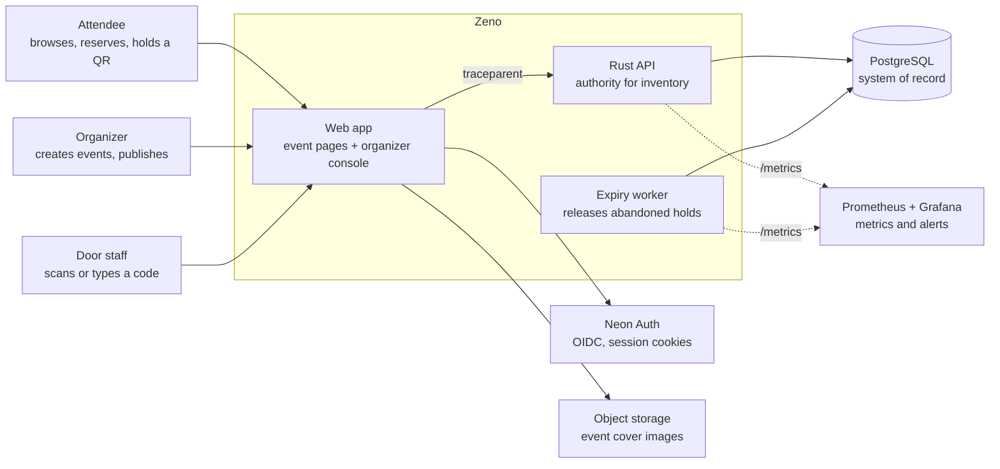
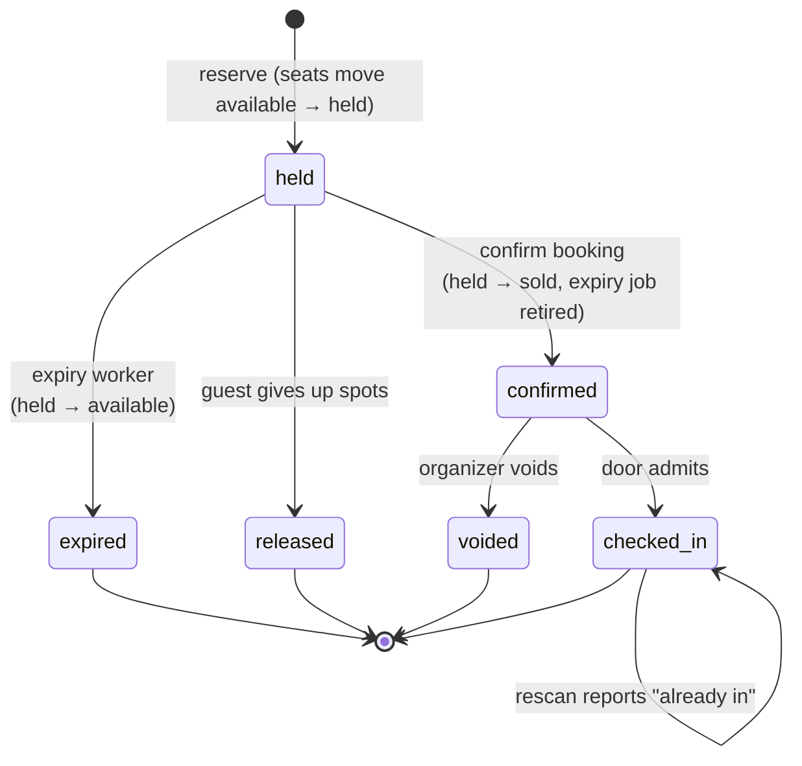
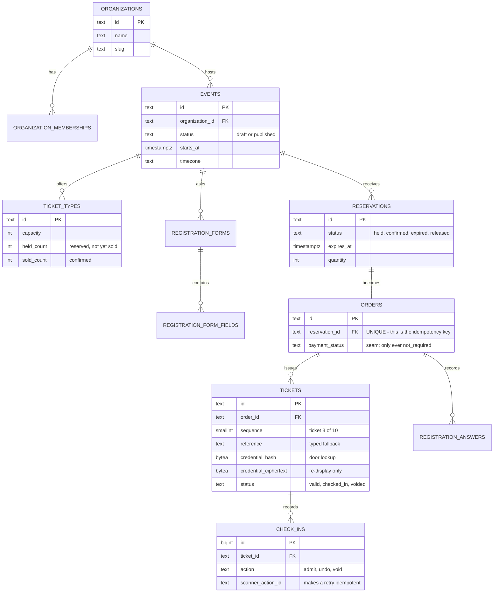
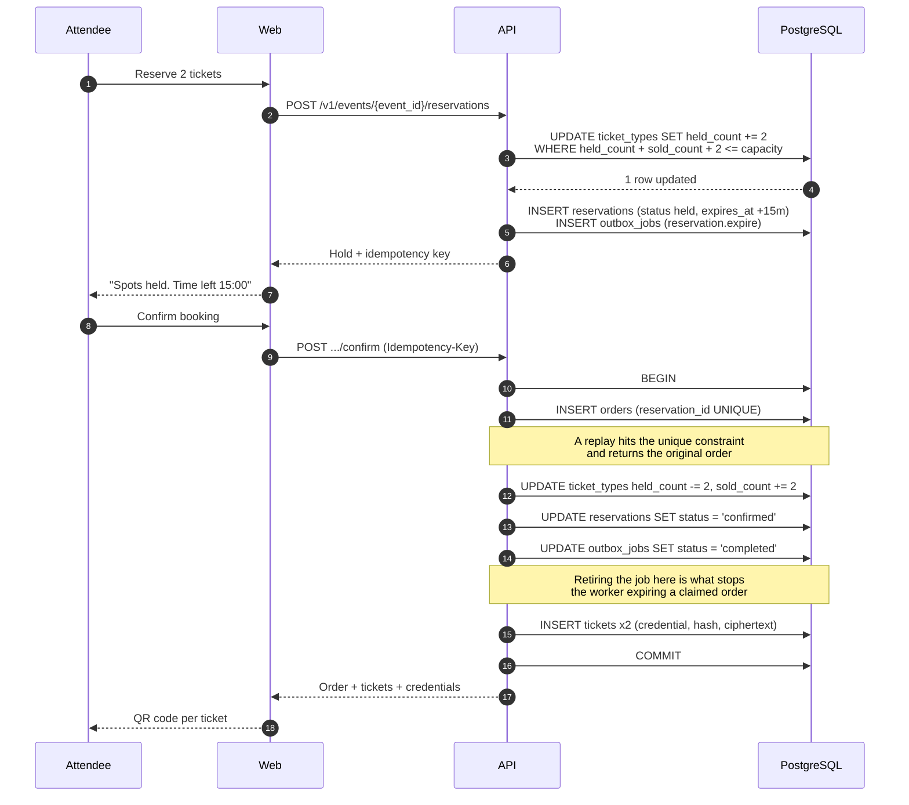
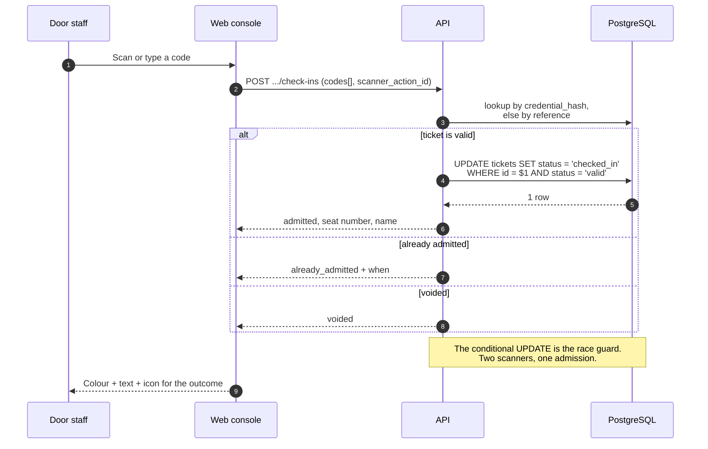
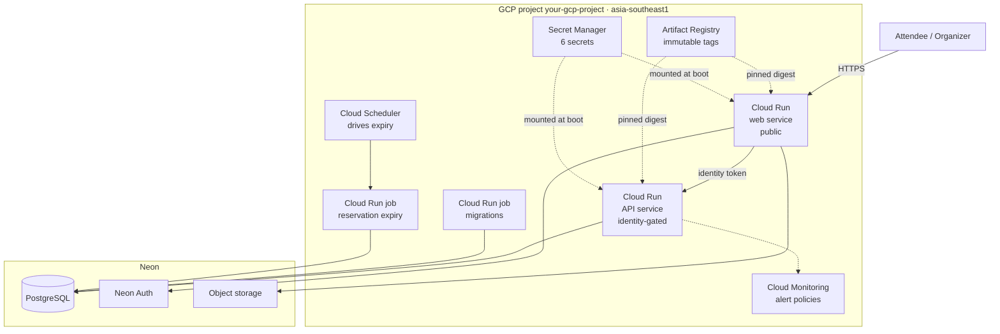
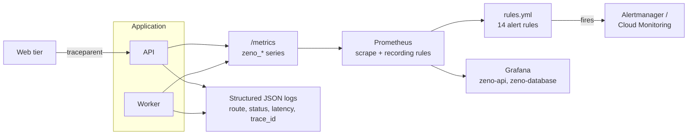

# Architecture diagrams

Diagram sources live here as text so they are reviewable in a pull request and
cannot drift from the code the way an exported image does.

The [README](../../README.md) carries a condensed set of three -- the reservation
lifecycle, the trust boundary, and the deployed topology -- so a first-time reader
meets the shape of the system without following a link. Those three are summaries.
This file is the full catalogue and is authoritative where the two differ: it keeps
the credentials, the sequence detail, and the data model that the README leaves out
on purpose.

## How to render or edit these

| Tool | What to do |
|---|---|
| GitHub / GitLab | Paste a block into any Markdown file. It renders natively. |
| <https://mermaid.live> | Paste a block. This is the fastest way to edit. |
| Excalidraw | **More tools → Mermaid to Excalidraw**, paste a block, then style it. This is the path to a hand-polished diagram you can export as PNG or SVG. |
| Eraser, Lucid, Notion | Most accept Mermaid pasted directly, or import it as a starting point. |
| CLI | `bunx @mermaid-js/mermaid-cli -i file.mmd -o out.svg` |

`zeno-architecture.excalidraw` in this directory is a ready-to-open Excalidraw
scene for the hero diagram, if you would rather not do the Mermaid import.

## 1. System context

Who uses Zeno and what it depends on. Everything inside the boundary is this
repository; everything outside is a service somebody else operates.

The API is not reachable from the internet in the deployed environment. Only the
web tier can call it, using a Cloud Run identity token. That is why the diagram
shows no direct edge from a person to the API.

## 2. Reservation lifecycle

This is the state machine that keeps a flash sale from overselling. The
interesting part is that "confirmed" and "expired" are mutually exclusive by
construction: confirmation retires the scheduled expiry job inside the same
transaction, so the worker can never release inventory that a guest has claimed.

Two invariants hold at every point:

- A seat is counted in exactly one bucket: `available`, `held`, or `sold`. The
  conditional `UPDATE ... WHERE held_count >= n` is what makes concurrent claims
  safe without a lock held across the whole transaction.
- Admission is a conditional update on `tickets.status = 'valid'`, so two scanners
  racing on one credential produce one admission and one honest "already in".

## 3. Data model

The shape that matters: one hold produces one order, and one order produces N
independently check-in-able tickets. That is what lets a company buy ten seats and
have ten colleagues arrive separately.

`held_count` and `sold_count` are denormalised counters, not derived on read. That
is a deliberate trade: the read path stays constant-time during a flash sale, and
correctness is carried by conditional updates that cannot decrement below zero.

`credential_hash` and `credential_ciphertext` exist for different reasons and
different failure modes. The door looks tickets up by hash, so admission survives
a lost encryption key. Re-displaying a QR needs the ciphertext, so that does not.

## 4. Confirming a booking

Shows why a retried confirmation cannot create a second order, and why the expiry
worker cannot later steal the seats back.

## 5. Admission at the door

The console shows a specific outcome rather than a generic failure, because "it
did not work" at a door is not actionable and "already used, admitted at 21:07" is.

## 6. Reference deployment topology

Images are referenced by digest, not by tag, so a redeploy cannot silently pick
up a different build. The API service has no public ingress; the web tier proves
its identity with a token, which is why the API-to-internet edge does not exist.

## 7. Telemetry path

One `traceparent` from the web tier is continued by the API, so a single trace ID
appears in both services' logs. See
[the observability runbook](../operations/OBSERVABILITY_RUNBOOK.md) for queries
and drills.

## Reading order

If you are reviewing this project rather than running it, this order explains the
most with the least context:

1. **Reservation lifecycle** — the correctness core, and the answer to "how do you
   not oversell a flash sale".
2. **Confirming a booking** — where idempotency and the expiry-retirement
   interaction actually live.
3. **Data model** — why one hold becomes N independently scannable tickets.
4. **Admission at the door** — the conditional update that makes concurrent scans
   safe.
5. **Deployed topology** — the blast radius of each component and its credentials.
