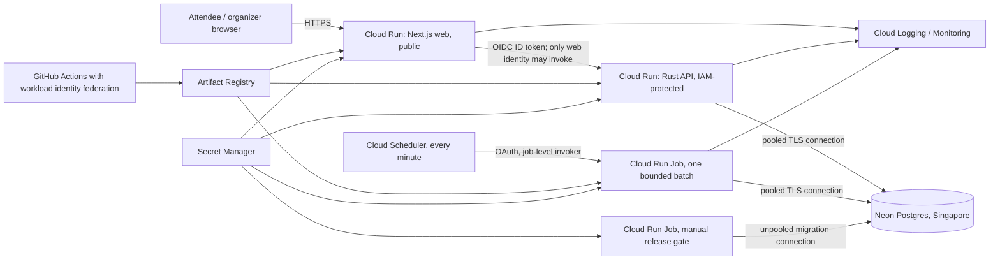

# GCP deployment architecture

**Status:** reference architecture. The configuration in `infra/gcp` has been
applied end to end in a disposable project in `asia-southeast1` and then
destroyed. The shape below describes what that deployment produces, not a
proposal. The default posture is non-production: the web service is public on
its `run.app` URL (`allow_public_default_uri = true`), so there is no load
balancer and no Cloud Armor, and `production_release` remains `false`.

## Recommendation

Deploy the current modular monolith as four Cloud Run workloads in `asia-southeast1` (Singapore): a Next.js web service (private for the initial smoke test, then public only behind the HTTPS load balancer), a private Rust API service, a bounded reservation-expiry Cloud Run Job invoked by Cloud Scheduler, and a manual migration job. Each expiry run processes at most 100 holds and deletes up to 1,000 idempotency records past the 24-hour replay window, then exits. The default one-minute schedule bounds additional hold-release delay to about one minute under normal operation; set an explicit objective and tune the interval after measuring database capacity and backlog recovery. Database row locks protect concurrent retries and overlapping cleanup. Keep PostgreSQL on Neon in `aws-ap-southeast-1`; do not introduce Cloud SQL or database replication. Use Artifact Registry for immutable container images, Secret Manager for database credentials, and Cloud Logging/Monitoring for runtime logs, service metrics, and alerts.

The Singapore pairing follows the linked Neon branch's region (`aws-ap-southeast-1`). Confirm the target user's location and data residency requirements before promoting this to a real pilot. The project, its enabled APIs, the remote state bucket, and the regional service availability are in place and were applied through the `infra/gcp` OpenTofu root rather than by hand.



## Workload boundaries

- **Web:** private smoke deployments use the authenticated Cloud Run URL. Public deployments route through a global external HTTPS Application Load Balancer with a Cloud Armor policy; Cloud Run ingress is limited to internal traffic and the load balancer, and its default `run.app` URL is disabled so requests cannot bypass the edge policy. The initial policy throttles only `POST /api/reservations` per source IP, with preview mode and a configurable starter threshold. Tune from preview logs and shared-network tests; Cloud Armor limits are approximate abuse controls, not strict quotas, and botnets can distribute traffic. Public release also requires a controlled DNS name and an active managed certificate. The web server calls the API using a Cloud Run ID token and its dedicated runtime service account. The API grants `roles/run.invoker` only to that identity; do not grant `allUsers` access to the API.
- **User identity:** Neon Managed Auth is the sign-in integration in the web source. The GCP module passes the issuer URL to the web service, issuer and JWKS URLs to the API, and a pinned cookie-signing secret from Secret Manager to the web identity. The `production_release` infrastructure gate requires this wiring, but it does not prove a successful sign-in, session refresh, or tenant-denial test. The API's opt-in `GET /v1/auth/me` validates Neon EdDSA access tokens when `NEON_AUTH_BASE_URL` and `NEON_AUTH_JWKS_URL` are both configured; those URLs are not secrets. The API has app-owned organization and membership records plus authenticated organization list/create and tenant-scoped event authoring routes. Do not add auth configuration to a shared database branch or treat a valid identity as permission to edit event resources. The Web-to-API Cloud Run ID token travels in `X-Serverless-Authorization`, leaving `Authorization: Bearer` for the user token.
- **API:** stateless Cloud Run service with IAM invocation enabled and no `allUsers` invoker grant. Its service URL is routable, but unauthenticated callers cannot reach the container. OpenTofu caps the API at three instances with four SQLx connections each, the expiry job at one task with two connections, and the migration job at one task with two connections: 16 simultaneous connections in the configured maximum case. The local default of 20 connections per process is too high for an unconstrained serverless fleet. Use the Neon pooled endpoint for application traffic and confirm the selected Neon plan's limit and pool behavior before deployment; the runtime now uses the pooled URL with the DML-only `zeno_runtime` role, and the migration job is the only consumer of the unpooled owner URL.
- **Expiry worker:** a standard Cloud Run Job drains one batch of at most 100 expired holds, then purges up to 1,000 idempotency rows only after their 24-hour replay deadline. Cloud Scheduler invokes the Cloud Run Jobs API using a dedicated service account with `roles/run.invoker` only on this job; that identity cannot read database secrets. The job has one task, one task retry, a 60-second timeout and a stable heartbeat ID. Cloud Monitoring alerts on failed executions. The default one-minute schedule can add almost a minute of hold-release delay; verify the actual objective and backlog recovery before a pilot. A queue-triggered design is another option if measured workload justifies it.
- **Public-release invariant:** OpenTofu blocks the `production_release = true` assertion unless workloads and public web are enabled, the expiry schedule is active, `public_domain` is a valid hostname, the Cloud Armor reservation throttle is enforced, a verified responder channel is attached through `monitoring_notification_channels`, Neon Auth issuer/JWKS URLs plus a pinned cookie-secret version are configured, and the selected Neon Object Storage endpoint/region plus both pinned web-only storage secret versions are configured. A public synthetic preview may use Cloud Armor preview mode to collect logs, but it is still internet-accessible and must not receive real attendees. Review and tune traffic before asserting production release. A private smoke deployment can disable the scheduler, but public reservation traffic must not be exposed until the scheduled expiry job is active; otherwise holds would retain inventory indefinitely. This infrastructure gate is not proof that the product is ready to sell tickets or that the Auth or storage provider flows work.
- **Migrations:** a Cloud Run Job using a separate migration credential, run explicitly before shifting web/API traffic. Never run migrations in API startup or on every replica. The migration URL is unpooled. The dedicated migration role exists: the migration job holds the owner credential, which is the only credential permitted to run DDL, and it is not an application runtime secret.
- **Containers and delivery:** the existing multi-stage Dockerfiles are built and pushed as immutable digests to Artifact Registry, and those exact digests are deployed; prior Cloud Run revisions are retained for rollback. Delivery runs from GitHub Actions over Workload Identity Federation rather than a downloaded service-account key. See "Continuous delivery" below.
- **Observability:** use Cloud Run request/container metrics and structured JSON logs in Cloud Logging. The OpenTofu root creates starter warning alerts when either web/API 5xx responses exceed 5% or successful-request p95 latency exceeds 2.5 seconds for five minutes, and when an expiry job execution fails. Tune these thresholds after collecting a representative baseline. Attach a verified Cloud Monitoring notification channel through `monitoring_notification_channels`; production release is rejected when none is configured. Database connection pressure and outbox backlog alerting remain follow-up work. The existing Prometheus/Grafana stack remains useful locally; do not expose its unauthenticated demo configuration publicly.
- **Object storage:** the web source has a draft-only event-cover workflow backed by a private Neon Object Storage bucket. The web server validates image signatures, decodes and resizes uploads, normalizes them to WebP, and stores event-scoped keys; Postgres stores the key and accessible alt text. Draft-image reads require organizer authorization, while public-image reads require a published event. S3-compatible credentials are injected only into the web Cloud Run service from pinned Secret Manager versions; the API and worker receive none. Verify the path against an isolated Neon branch before relying on it. Keep the storage branch, region and endpoint aligned with the database branch. Use scoped credentials, preserve the bucket's private access mode, and never put key values in Terraform state, variables, command lines, images or Git. Cloud Storage via service identity remains a valid alternative if measured requirements favor it.

## Database and release safety

Use an isolated Neon branch or project for a deployment. The runtime connects as a
DML-only role (`zeno_runtime`) that cannot create, alter, or drop anything; the
owner credential (`neondb_owner`) is consumed only by the migration job. Treat the
owner credential as privileged and the runtime credential as bounded. Do not point
a demo deployment at a branch that holds data you care about.

For the first GCP release, create a dedicated Neon branch or project for the demo, provision separate runtime and migration roles, and use a pooled TLS URL for the runtime role. Keep each value in Secret Manager, grant access per runtime service account, and pin secret versions in each Cloud Run revision. Use a distinct migration secret for the migration job. Store no credential in Terraform state, Docker build arguments, image layers, command-line arguments, GitHub variables, or repository files. Secret values should be added through a secure local file/stdin workflow after project access is available.

Deployment order:

1. Authenticate and inspect the target GCP project, billing status, enabled APIs, existing resources, quotas, and IAM before changing it.
2. Confirm the Neon branch/data is synthetic or create an isolated deployment branch. Create an application role with only required table operations and a separate schema migration role. Create storage credentials for that same isolated branch and place their values directly into the Terraform-created Secret Manager secrets without routing them through Terraform state.
3. Build and scan images; push commit-SHA tags to Artifact Registry.
4. Apply the infrastructure plan and add secrets outside Terraform state.
5. Run the migration job against the isolated branch and inspect its result, including migration `0013_event_cover_image`.
6. Deploy the API privately, then the web service with its service-to-service ID token configuration; run the expiry job once manually and confirm the Scheduler trigger is active before making the web public.
7. Verify readiness, public read flow, idempotent reservation and replay, expiry processing, organizer authentication/denial, cover-image upload/read/remove, log/metric visibility, and the maximum database connection count using synthetic data.
8. Record the image digests, migration version, rollback revision, smoke-test evidence, monthly cost estimate, and teardown procedure.

## Not production-ready yet

This is a public demonstration, not a live ticketing launch. Payment capture and email delivery are absent: `orders.payment_status` is the seam for a future payment integration, and only `not_required` is ever written. Online QR check-in exists and is exercised through the organizer door console, including partial check-in for multi-ticket orders; offline scanning is a deliberate non-goal. Before a real pilot, verify the organizer sign-in/session flow end to end, test request-rate/abuse controls, rehearse backup/restore, decide data retention, create and verify a responder channel and attach it through `monitoring_notification_channels`, and test migration rollback/forward recovery.

The first deployment intentionally avoids GKE: this repository has a few small container workloads and no Kubernetes-specific requirement. GKE would add cluster operations and baseline cost before it improves the customer journey. It remains a bounded, optional exercise after a Cloud Run deployment is measured.

The public edge uses [Cloud Armor per-client throttling](https://cloud.google.com/armor/docs/rate-limiting-overview) on a serverless NEG behind an external Application Load Balancer. Cloud Run ingress and its default URL are restricted so public requests traverse the load balancer, following [Cloud Run's ingress guidance](https://cloud.google.com/run/docs/securing/ingress). These controls mitigate repeated traffic; they do not create identity-aware quotas or guarantee exact limits.

## Reference defaults

- The `infra/gcp` root creates the foundation, the four workloads, the monitoring policies, and the GitHub federation through OpenTofu rather than by hand.
- The runtime connects as `zeno_runtime`, which holds DML on `public` and cannot create, alter, or drop anything. The owner credential is confined to the migration job.
- Delivery runs from GitHub Actions over Workload Identity Federation when the repository variables in `.github/workflows/deploy.yml` are configured.
- The default module posture is a public `run.app` URL with no load balancer and no Cloud Armor, because `public_domain` is empty and `production_release` is `false`. Anyone holding the URL can reach it, so it must not receive real attendees.
- The Grafana stack is local-only. Its dashboards are not exposed by the deployment.
- OTLP span export to Cloud Trace is implemented for all three workloads, which is the second pillar [ADR-0009](../adr/0009-serverless-observability-and-ebpf-evaluation.md) named. A browser request is one trace: the web tier's request span is the root, the render and fetch spans hang off it, and the API's span nests below. Every span adopts the `traceparent` identifiers the JSON logs already carry, so a log line and a trace are the same request, and sampling is parent-based so the root decides once. One limit is worth stating: health probes are deliberately not traced, because at a ten-second liveness interval they were 40 of 45 spans in a sampled window. Cloud Run also emits a platform span per request, which carries no route, method, or request ID; those are not ours and are not the ones to read.

## Continuous delivery

A push to `main` runs `.github/workflows/deploy.yml`. Configure branch protection to require a pull request and the four CI checks, so the pipeline ships the commit that was reviewed rather than re-deciding what to ship.

Authentication is Workload Identity Federation, not a service-account key. A key is a bearer credential that never expires and survives in workflow logs and laptop backups; instead GitHub mints a short-lived OIDC token per run and Google exchanges it for credentials that die with the job. The provider is pinned with `attribute_condition = "assertion.repository == 'WarunaUdara/zeno-platform'"`, so a fork or a copied workflow cannot borrow the identity. The deploy identity holds `roles/run.developer` rather than `roles/run.admin`: it can create revisions but cannot rewrite a service's IAM policy.

The release order is build and push both images, roll the migration job forward to the new API image and execute it, then roll the API, the expiry worker, and the web tier. Migrations run before the API moves so a release never runs code against a schema older than itself. That ordering only holds while migrations are additive; a destructive change would need expand/contract.

Terraform owns everything about a workload except its image, and the pipeline owns the image. The four workloads carry `ignore_changes` on the image field. Without it the next `tofu apply` would silently roll the live revision back to the digest pinned in `terraform.gcp.tfvars`, so the two would fight over one field and whoever ran last would win.

**That split has a consequence worth stating plainly: only the image is continuous.** Environment variables, IAM bindings, secret wiring, scaling settings, and alert policies are applied by hand, so merging an infrastructure change to `main` does not deploy it. The change passes CI, which formats, validates, and runs `tofu test` against the emulator, and then has no effect on the target project until someone runs `tofu apply`.

Treat the apply as a separate, reviewed release step. A merged commit that changes infrastructure is not evidence that the change is live.

The root reason CI cannot close this itself is that the state backend is local, so a GitHub runner has nothing to plan against and no way to detect drift. Two options, in increasing order of effort:

1. Run `tofu plan -detailed-exitcode` in CI against a restored state and fail the build on drift, leaving the apply manual. Drift becomes visible before merge rather than after.
2. Move state to the GCS backend that `infra/gcp/verify-floci.sh` already emulates, then apply from the pipeline under the same Workload Identity Federation identity the deploys use.

Option 2 is the shape a real system wants, and it needs the state move to be rehearsed rather than attempted casually. Until one of them is done, `tofu apply` is a release step that is easy to forget and produces no error when it is.

A rollout that returns success but serves errors is not a rollout, so the final step requests `/`, `/events`, and `/auth/sign-in` from the deployed web service and fails the run unless all three return 200.

## Troubleshooting

### Google API calls hang on a VPN that blackholes IPv6

Symptom: `gcloud`, `tofu`, or a script calling a Google API hangs for one to five minutes, then may still succeed. `curl` to the same endpoint is fast.

Cause: Google API hostnames return both A and AAAA records, and many clients prefer IPv6. If a VPN supplies IPv4 only and drops IPv6 silently rather than rejecting it, the IPv6 connection attempt waits out the full TCP timeout instead of failing fast. `curl` survives because it implements Happy Eyeballs and falls back to IPv4 within milliseconds; clients that do not — Python's `urllib`, some `gcloud` paths — do not.

Diagnose it rather than guessing:

```bash
# Does the host even offer IPv6?
dig +short AAAA storage.googleapis.com | head -3

# If it does, does the IPv6 address answer, or silently drop?
curl -6 --max-time 5 -sS -o /dev/null -w '%{http_code}\n' https://storage.googleapis.com
```

If AAAA resolves but the `-6` request times out while `-4` succeeds, the network is dropping IPv6 rather than not offering it.

Do not fix this by forcing IPv4 inside the product. A hardcoded IPv4 preference breaks every environment with working IPv6, which is the direction the internet is moving, and it hides a network fault behind application code. The real fixes are at the network layer: allow IPv6 through the VPN, or disable IPv6 on the host interface so the resolver stops offering AAAA records at all. `gcloud` has no supported address-family switch; narrowing the family inside a one-off script is a local diagnostic, not a product change.

## Verification

These checks were run when the reference deployment was applied:

- The reservation path: reserve returns `201`, an idempotent replay returns the
  same reservation id, and confirm returns `200` — all on the least-privilege
  runtime credential.
- The expiry worker ran green on consecutive minutes against that same credential.
- The delivery pipeline ran end to end: both images built and pushed, the
  migration job executed, all four workloads rolled forward to the recorded
  digests, and the web smoke test returned 200 on `/`, `/events`, and
  `/auth/sign-in`.
- The least-privilege role was verified in both directions: it can read
  application tables, and `CREATE TABLE` is refused with `permission denied`.
- Local Compose still passes the event-page and idempotent reservation replay
  smoke test, and CI runs that stack plus the API, web, and infrastructure checks
  on every pull request.
- Spans reached Cloud Trace: a sampled window listed traces whose spans are named
  `http_request` under the API's `service.name`, and each carried the `trace_id`
  the JSON log for that request reports, so a log line and a trace are the same
  request. A second window taken after real traffic through the public URL
  contained no health-probe spans, which is the probe exclusion holding live
  rather than only in a test.
- Both exporters are checked on every pull request without a cloud project.
  `infra/observability/verify-trace-export.sh` stands in for the metadata server
  and the collector, then asserts that probes export nothing and that a traced
  request produces a payload naming the span and carrying the caller's trace id.
  `verify-web-trace-export.sh` does the same for the web tier against its
  production build, and parses the OTLP/JSON payload to assert the shape of the
  trace: a root span with work nested under it.
- What remains unverified in a fresh environment: a successful Neon Auth sign-in
  in a browser, the object-storage cover-image path against a live isolated
  branch, and migration rollback recovery.

## References

- [Cloud Run overview: services, jobs, and worker pools](https://docs.cloud.google.com/run/docs/overview/what-is-cloud-run)
- [Cloud Run worker pools](https://docs.cloud.google.com/run/docs/deploy-worker-pools)
- [Execute Cloud Run jobs on a schedule](https://docs.cloud.google.com/run/docs/execute/jobs-on-schedule)
- [Cloud Run maximum concurrency](https://docs.cloud.google.com/run/docs/about-concurrency)
- [Cloud Run maximum instances](https://docs.cloud.google.com/run/docs/configuring/max-instances)
- [Cloud Run Secret Manager integration](https://docs.cloud.google.com/run/docs/configuring/instances/secrets)
- [Cloud Run service-to-service authentication](https://docs.cloud.google.com/run/docs/authenticating/service-to-service)
- [Neon agent skill](https://neon.com/.well-known/agent-skills/neon/SKILL.md)
