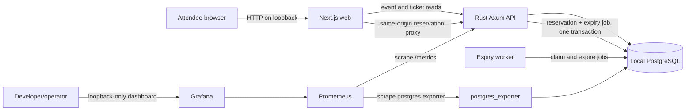
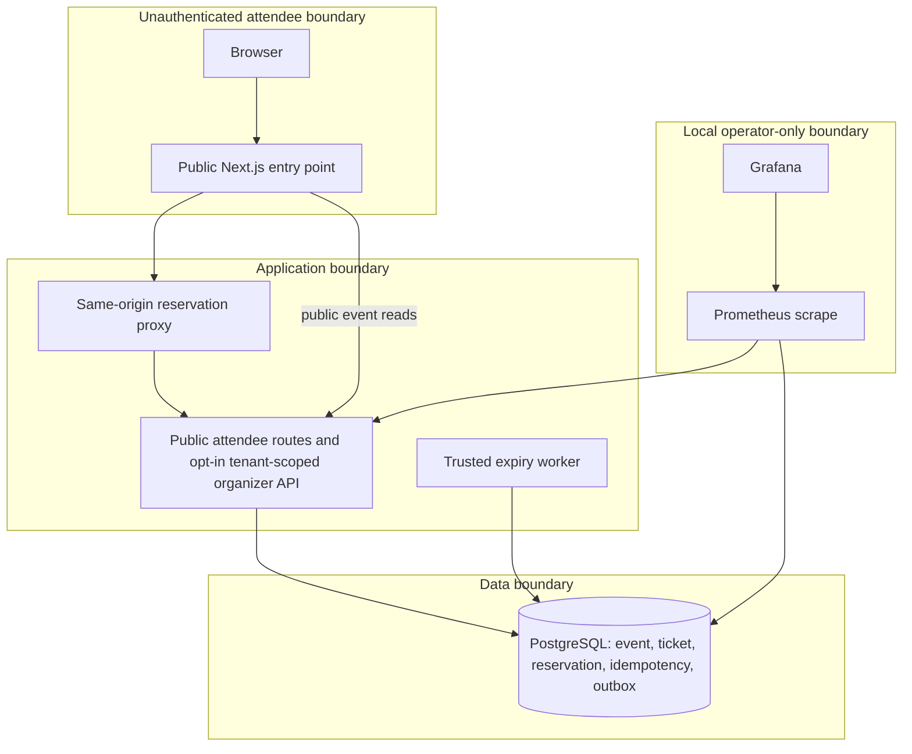

# Implemented runtime and trust boundaries

This is the current source-verified system shape as of 2026-10-09. It describes local Compose and the demo API. It must not be confused with a deployed GCP architecture: no GCP resources have been created.

## Running local demo



Compose binds the web, database, Prometheus, and Grafana host ports to loopback. The API and worker communicate on the private Compose network; `/metrics` is not a user interface. Local Grafana uses demo-only credentials and is for operators. The event is a synthetic seeded record. Catalog reads return a bounded event summary; event detail may include optional organizer-supplied accessibility, cancellation/transfer, and support disclosures. Reservation writes create anonymous, expiring inventory holds. When Neon Auth issuer and JWKS URLs are explicitly configured, the API verifies identity and supports organization listing/creation plus tenant-scoped draft event listing, creation, editing, ticket list/edit, and publication. Ticket and event retries are safe, and cross-tenant event writes are denied. The web source includes Neon Auth sign-in/session routes and an organizer workspace/editor, but this environment has no configured provider session, so the end-to-end authenticated browser flow remains unverified. There is no payment provider, confirmed order/ticket issuance, email, or admission scan.

## Trust boundaries and current exposure



The browser can create inventory holds without an account, so this is suitable only for a bounded synthetic demo until distributed abuse controls exist. The proxy forwards the idempotency key and validated reservation body; it does not establish organizer identity or tenant context. Identity verification is opt-in and does not itself grant access to event data. Organizer API queries derive the principal from a verified issuer/subject pair and check both the organization and an allowed role in each write predicate; the database also enforces that ticket and event organization IDs match. Browser sign-in/session source exists but needs provider-backed verification; invitations, role changes/revocation UX, event-scoped assignments, and an audit log are missing. The expiry worker is a trusted internal process that changes only due reservation/outbox/inventory state. Prometheus/Grafana are local operations tools. Do not expose their current Compose defaults publicly.

The proposed GCP boundary differs: a public Cloud Run web service invokes an IAM-protected API with its service identity; API and worker use narrowly granted Secret Manager values and a Neon application role. That deployment is not verified. See [GCP deployment](GCP_DEPLOYMENT.md).

## Reservation and expiry transaction

```mermaid
sequenceDiagram
  participant B as Browser
  participant W as Next.js proxy
  participant A as Axum API
  participant P as PostgreSQL
  participant X as Expiry worker
  B->>W: POST reservation + random Idempotency-Key
  W->>W: bound/validate request and fixed demo event
  W->>A: POST versioned reservation route
  A->>A: validate IDs, quantity, key; hash canonical request
  A->>P: BEGIN; claim 24h key or load replay
  alt unexpired key, same fingerprint
    P-->>A: stored reservation response
  else key reused with different fingerprint
    P-->>A: conflict; transaction rolls back
  else fresh or expired key
    A->>P: lock ticket type; validate published event and sale window
    opt request needs capacity released from already-expired holds
      A->>P: expire at most 100 due holds; decrement held counter; complete expiry jobs
    end
    A->>P: guard capacity; increment held count
    A->>P: insert reservation and due expiry outbox row
    A->>P: save stable idempotency response
    A->>P: COMMIT
  end
  A-->>W: created/replayed hold or problem
  W-->>B: response; browser displays expiry countdown
  loop worker polling
    X->>P: select due jobs in bounded batch with row locks / SKIP LOCKED
    X->>P: lock ticket rows in deterministic order
    X->>P: expire holds, complete jobs, release inventory atomically
    X->>P: record per-instance heartbeat
  end
```

The database is authoritative for inventory. A published availability read is advisory and can become stale before checkout. The single ticket-type row is the serialization point that prevents oversell; it is also the expected hot-event throughput ceiling. Reservation expiry is 15 minutes; the idempotency replay contract is 24 hours and separate. Failed reservation transactions roll back key claims and inventory changes. The worker removes expired idempotency rows in bounded batches; the local worker runs cleanup hourly by default and the hosted expiry job runs it with each scheduled batch. The browser keeps a pending idempotency key and the non-sensitive hold confirmation in session storage, so a reload in the same tab can replay an interrupted request or restore the active hold details. The hold still expires on the server after 15 minutes and is not a ticket.

Migration 0008 removes purchaser email from the reservation contract and table because the demo sends no confirmation or ticket and has no retrieval flow. It also replaces fingerprints that included email with random values while keeping idempotency keys and their stored responses, so in-flight clients may receive a conflict until those keys reach their existing 24-hour deadlines rather than create duplicate holds. PostgreSQL does not immediately reclaim the old column's on-disk tuple space after `DROP COLUMN`; if real attendee data existed, schedule a table rewrite and expire backups/WAL under the retention policy before claiming physical erasure ([PostgreSQL `ALTER TABLE`](https://www.postgresql.org/docs/current/sql-altertable.html)). No payment/order transition exists after a hold.

## Boundary inventory

| Boundary | Current implementation | Missing before SaaS |
| --- | --- | --- |
| Identity | Opt-in Neon EdDSA token verifier and `/v1/auth/me`; web source includes Neon Auth session/sign-in routes, organizer guard, and server-side user-token forwarding | Provider-backed browser session/sign-in, logout/refresh and account lifecycle are unverified; local Auth configuration is absent; verified contact only when required |
| Tenant authorization | App-owned organizations and issuer/subject memberships; event reads/writes require membership, write roles are checked in SQL, and ticket/event tenant keys have a composite foreign key | Invitations, role changes/revocation, event-specific assignments, audit log, production IdP verification |
| Event catalog | Upcoming public event list with bounded cursor pagination, public event detail by ID and ticket reads; authenticated API and web source can list/create/edit drafts, add tickets idempotently and publish after readiness checks | Authenticated editor browser flow remains unverified; preview and post-publication change policy, slug-based attendee URLs, search, venue/accessibility/policy detail |
| Inventory | PostgreSQL ticket-type lock, transactional hold, replay key and expiry job | Load-derived admission/rate controls, cancellation, completed order and payment transitions |
| Jobs | One expiry worker; bounded batch; database heartbeat | Retry/dead-letter policy for external jobs, job retention/cleanup and multi-region ownership strategy |
| Integrations | OpenAPI + generated TS client for attendee, identity, organization and organizer draft/publish routes | Authenticated scoped developer credentials, compatibility policy, webhooks and provider adapters |
| Observability | Prometheus/Grafana/Postgres exporter locally; Cloud Monitoring Terraform for native Cloud Run 5xx/latency if deployed | Hosted custom worker/DB/outbox telemetry, trace export, notification receiver, runbooks and measured objectives |

See [the complete current evidence ledger](../audits/2026-10-08-coverage-ledger.md) for per-journey status, verification scope, access limits and outstanding evidence.
