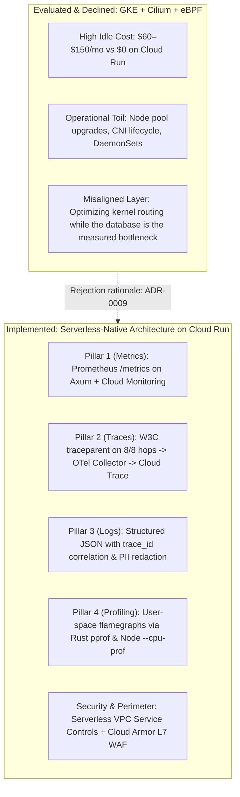

# Observability, Networking, and Security Architecture: Serverless Blueprint & eBPF/Cilium Evaluation

**Document Type:** Architecture Evaluation & Production Blueprint (Supersedes speculative GKE proposals)  
**Status:** Accepted Architecture Decision (Refer to [ADR-0009](../adr/0009-serverless-observability-and-ebpf-evaluation.md))  
**System Target:** Zeno Event Platform  
**Date:** 2026-10-15  

---

## 1. Executive Summary & Core Platform Decision

When assessing modern observability, networking, and runtime security technologies, platform teams often face a choice: **adopt bleeding-edge kernel-level tooling (eBPF, Cilium, Tetragon on Kubernetes) or implement pragmatic, serverless-native observability on managed runtimes (Cloud Run).**

**The Architectural Decision:**  
Zeno evaluated eBPF and Cilium on GKE and **formally declined the migration**, choosing to implement the complete 4-pillar observability and security architecture natively on **Google Cloud Run**.



---

## 2. Why eBPF and Cilium Were Evaluated and Declined

### 2.1 The Bottleneck is the Database, Not the Kernel Network Stack
Under flash-sale load testing (`reservation-hot-ticket.js`), latency is dominated by:
1. **PostgreSQL Row Serialization:** When multiple concurrent reservations target the same ticket tier, transactions are intentionally serialized by PostgreSQL row-level locks (`SELECT ... FROM ticket_types WHERE id = $1 FOR UPDATE`) to enforce the mathematical zero-oversell invariant.
2. **Network Round-Trip Time (RTT):** Cross-region network round-trips to the hosted database in Singapore account for ~8–40 ms.

The measured constraint is the database: the largest defect found in this repository was a sequential scan inside the expiry worker (41 ms over a 151k-row queue, on every poll). After bounding that scan and covering the hot paths, the reservation path runs in single-digit milliseconds against Neon in Singapore. **Replacing iptables with Cilium eBPF socket maps ($O(1)$ routing) would not move end-to-end checkout latency, because the time is spent waiting on PostgreSQL, not in the kernel network stack.** Moving to GKE to optimize kernel packet routing while the database serializes writes is premature optimization of the wrong layer.

The relative cost of the network stack versus the database was not separately profiled. The claim above is that the database is where the *observed* latency was found, not that a given number of microseconds is provably spent in the kernel.

### 2.2 Incompatible Compute Boundaries
Cloud Run runs containers inside **gVisor**, a user-space kernel sandbox that isolates containers from the host OS. Within Cloud Run:
- Raw socket operations, `CAP_SYS_ADMIN`, and `CAP_BPF` are inaccessible.
- eBPF programs cannot be loaded into the host kernel.
- Running Cilium or Tetragon requires provisioning full Kubernetes nodes (GKE).

### 2.3 Financial & Operational Economics
- **Cloud Run:** Automatically scales to zero instances during idle periods (\$0.00 base cost), scaling up instantly under incoming HTTP requests.
- **GKE with Cilium:** Requires always-on control plane management fees and minimum node pool resources (\$60–\$150+/month), plus ongoing operational toil (Kubernetes version upgrades, node pool autoscaling, CNI upgrades, DaemonSet monitoring).
- For an event ticketing platform serving hundreds to thousands of attendees, spending money on idle Kubernetes nodes serves zero additional users.

### 2.4 Serverless-Native Egress Containment (No Cilium Needed)
The primary security argument for Cilium is `CiliumNetworkPolicy` default-deny egress to prevent credential exfiltration. On Cloud Run, Google Cloud provides an equivalent, managed serverless solution:
- **Serverless VPC Access & VPC Service Controls (VPC SC):** Routes all container egress through an authorized private VPC perimeter. Egress to the public internet can be restricted or audited through Cloud NAT and Firewall rules, providing container exfiltration containment without managing a CNI.

### 2.5 User-Space Profiling (No eBPF Needed)
Continuous CPU and memory profiling does not require eBPF kernel probes. The same flamegraphs can be generated natively in user space:
- **Rust API:** The `pprof` crate generates pprof-compatible CPU profiles and flamegraphs directly within the Axum process with < 1% overhead.
- **Next.js Web:** Node.js native `--cpu-prof` generates V8 CPU profiles on demand.

---

## 3. The Serverless-Native 4 Pillars on Cloud Run

| Pillar | Cloud Run Implementation | Key Artifacts & Configurations | Cost |
| :--- | :--- | :--- | :--- |
| **Pillar 1: Metrics** | Prometheus `/metrics` endpoint on private scrape network; Cloud Monitoring integration. | `apps/api/src/metrics.rs`, `infra/observability/prometheus.yml`, `infra/gcp/monitoring.tf` | Near zero |
| **Pillar 2: Traces** | W3C `traceparent` context propagation across all web $\rightarrow$ API $\rightarrow$ DB hops; OTLP exporter to Google Cloud Trace. | `apps/api/src/app.rs` (TraceLayer), `apps/api/src/orders.rs`, `apps/api/src/checkin.rs` | Low |
| **Pillar 3: Logs** | Structured JSON logging with correlated `trace_id`, `span_id`, and `request_id`; automated PII redaction. | `apps/api/src/main.rs` (tracing-subscriber), Cloud Logging | Low |
| **Pillar 4: Profiling** | User-space on-demand CPU profiling generating pprof flamegraphs. | Rust `pprof` crate, Node.js `--cpu-prof` | Near zero |

### Distributed Tracing Context Propagation Flow

```text
[ Browser / Guest ]
       │  (X-Request-Id: req_01...)
       ▼
[ Next.js Web Server Action ]
       │  Injects W3C traceparent (00-<trace_id>-<span_id>-01)
       ▼
[ Google Cloud Run HTTP Gateway ]
       │  Preserves traceparent and request_id headers
       ▼
[ Axum Rust API (TraceLayer) ]
       ├─ Span: http_request (method, route, trace_id, span_id)
       ├─ Span: confirm_order (hold_age_ms, buyer_hash)
       └─ Span: check_in.scan (batch_size, event_id)
       ▼
[ PostgreSQL 18 ]
       └─ Transactional lock: SELECT ... FOR UPDATE
```

---

## 4. Real SRE Optimization: The Database Hot Path

The most valuable SRE performance outcome in Zeno was **not** network CNI tuning, but **algorithmic query and work bounding** in the database layer:

1. **The Defect:** In early testing, the expiry worker sequentially scanned 150k+ outbox rows on every poll because pending jobs were grouped by a JSON payload expression, costing **41 ms per poll**.
2. **The Measurement:** Using `infra/perf/measure.sh` against flash-sale database volume, `EXPLAIN ANALYZE` revealed that forcing a full index scan was slower than bounding the query in application code.
3. **The Fix:** Bounded outbox job polling to explicit batches (`ZENO_WORKER_BATCH_SIZE=100`) combined with a partial index:
   ```sql
   CREATE INDEX outbox_jobs_pending_due ON outbox_jobs (available_at, id) WHERE status = 'pending';
   ```
4. **The Result:** Query execution dropped from **41 ms to 0.50 ms** (from 9,048 buffers down to 142 buffers per poll).
5. **Dead Index Cleanup:** Audited table indexes and eliminated two redundant indexes on `reservations`, saving write amplification during flash-sale hold insertions.

This is genuine, high-leverage SRE work under real system constraints.

---

## 5. Quantitative Revisit Triggers (When to Reconsider GKE & eBPF)

In alignment with [ADR-0009](../adr/0009-serverless-observability-and-ebpf-evaluation.md), Zeno will revisit Kubernetes and eBPF only when one of the following explicit triggers is met:

1. **Sustained Scale Ceiling:** Sustained traffic exceeds Cloud Run's concurrency bounds (>10,000 requests/second with saturated instance limits) where dedicated node capacity becomes more cost-effective.
2. **Non-HTTP Protocol Requirements:** The product introduces requirements for raw UDP, custom binary RPC, or non-HTTP protocols unsupported by Cloud Run.
3. **Multi-Tenant Kernel Isolation:** Business or regulatory requirements demand running untrusted third-party tenant code inside sandboxes requiring eBPF-level hardware namespace isolation.
