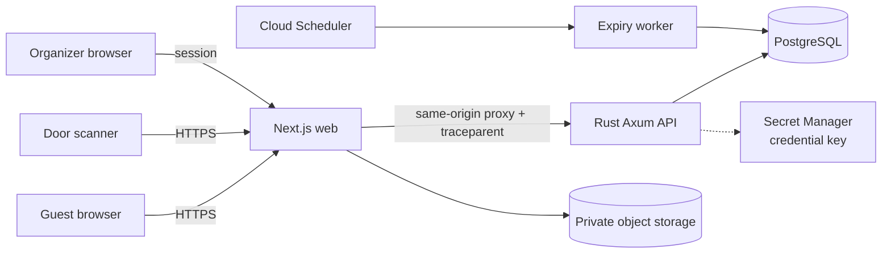
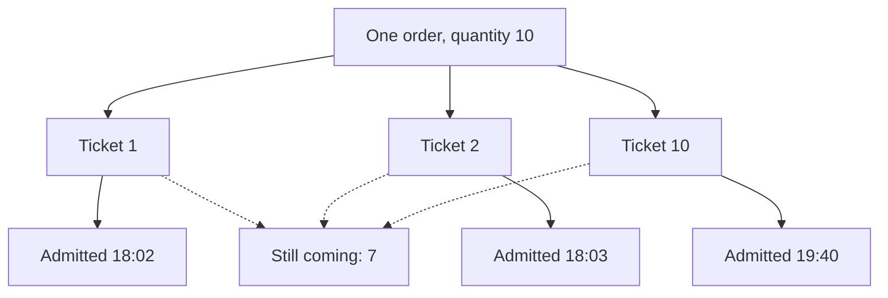
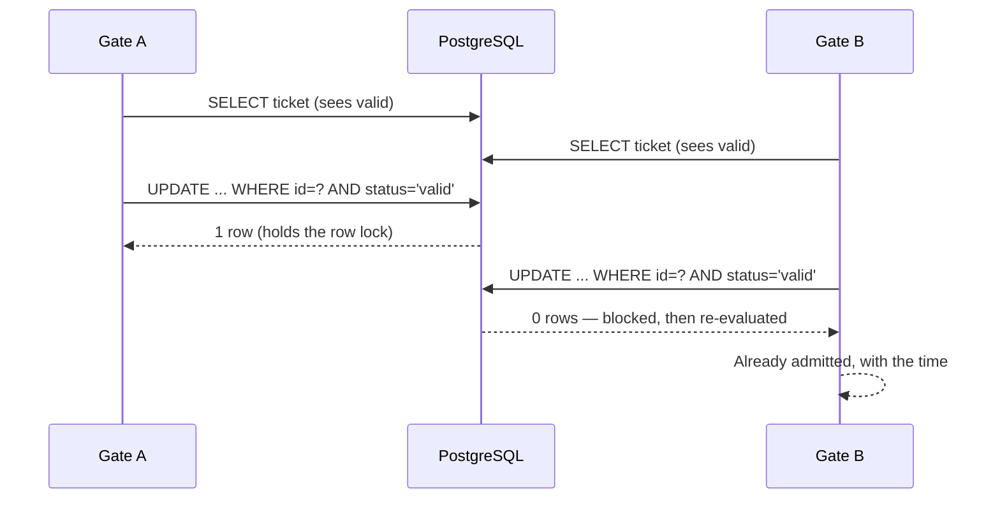

# Zeno: ticketing and entry architecture

How the system is shaped today, and why each shape exists. Written to be read
alongside the code; every claim here is exercised by a test or a recorded
measurement, and the limits are stated rather than implied.

## The product in one sentence

An organizer publishes an event, sells tickets, and admits guests by QR code at
the door — with the property that matters most at a live event: **a group booking
of ten tickets is ten independently check-in-able tickets**, so colleagues arrive
when they arrive.

## Runtime shape



A modular monolith plus one separately scheduled worker. There is no cache in the
inventory path and no message broker: PostgreSQL is the only authority for whether
a ticket exists, and every correctness property below depends on that being true.

## Order and admission lifecycle

```mermaid
stateDiagram-v2
  [*] --> held: POST reservations<br/>held_count += n
  held --> confirmed: POST confirm<br/>held_count -= n, sold_count += n<br/>one ticket row per unit
  held --> expired: worker releases a due hold<br/>held_count -= n
  held --> released: guest gives up their spots<br/>held_count -= n

  state valid {
    [*] --> valid
  }
  state checked_in {
    [*] --> checked_in
  }
  confirmed --> [*]

  note right of held
    15 minute window
    The lock order is what makes
    confirm and expire safe together
  end note
```

**The hold is where inventory is protected.** `ticket_types` carries
`capacity`, `held_count` and `sold_count`, with a database CHECK that
`held_count + sold_count <= capacity`. Correctness never depends on application
logic noticing an oversell; it depends on that constraint.

## Why a company of ten works without coordination



There is no attendance state on the order, and no code anywhere that knows how
many tickets an order has. Each ticket is admitted on its own. That is what makes
partial arrival the ordinary case rather than a special mode, and it is why
`awaiting` is simply "issued tickets not yet admitted" rather than a counter that
has to be maintained in step with the ticket rows.

## The two races, and how they are settled

### Two gates scan one guest



Both scanners can read "valid". Only the **row lock on the conditional UPDATE**
separates them. A read-then-write would admit the same guest twice under exactly
the race the feature exists to prevent.

### A checkout times out and is retried

`orders.reservation_id` is `UNIQUE`. That column *is* the idempotency key: the
database refuses a second order, so the guarantee does not depend on this code
remembering anything. A retried confirm returns the original order *and* re-renders
the ticket credentials, so a guest whose response was lost still has working QR
codes.

Proved by `concurrent_confirms_produce_exactly_one_order` (ten simultaneous
confirms, one order, two tickets) and `two_gates_scanning_the_same_guest_admit_exactly_one`
(eight simultaneous scans, one admission, one ledger row).

## Lock order

Every writer that touches reservations acquires locks in one sequence:

```
ticket_types  ->  outbox_jobs  ->  reservations
```

Confirm, release and the expiry worker all follow it. A confirm that took them in
a different order would deadlock against a worker expiring the very hold being
confirmed — a race a user triggers simply by confirming as the timer runs out.

## Credential handling

A QR credential must not be recoverable from a database read, and must be
re-displayable by the guest who owns the ticket. Both are true because two
representations are stored:

| Column | Form | Used for |
| :--- | :--- | :--- |
| `credential_hash` | SHA-256 digest | The door lookup. Irreversible. |
| `credential_ciphertext` | AES-256-GCM | Re-rendering the QR for its owner. |

The key comes from `ZENO_TICKET_CREDENTIAL_KEY`, held outside the database and
outside the same backup. A leaked database yields a digest that admits nothing and
ciphertext that is useless without the key. Confirmation **fails closed** without
the key rather than issuing tickets whose codes could never be shown again.

`reference` is a short typed alternative (`6735Q49P`) for a damaged or unreadable
QR code, using an alphabet with no `0`, `1`, `O` or `I` because those are the
characters staff misread across a noisy door.

## Registration forms are versioned, not edited

Publishing a form creates a new version and retires the previous one. A confirmed
booking stores the version it was validated against, and each stored answer keeps
the question's **label as it read at the time**. Renaming a question later
therefore cannot rewrite history or orphan answers.

Answers are validated against the published form *before* the order is written,
inside the same transaction, so a confirmed booking can never hold an answer that
no reader could interpret.

## Failure modes we chose not to build

| Not built | Why | What happens instead |
| :--- | :--- | :--- |
| Offline scanning | Disconnected gates cannot coordinate global single-use. Reconciling that is a larger design than the problem warrants before a pilot. | Online-only, stated plainly in the product copy. |
| Payments | No merchant of record or provider is chosen. | `payment_status` is a documented seam with one value, `not_required`. |
| General theming | Needs a design lifecycle before it can be bounded. | One cover image, already shipped. |
| Attendee accounts | The purchaser needs to reach their tickets, not an identity system. | Tickets are returned at confirmation and re-derivable by the API. |

## What is not verified

Stated here because a reader should not have to discover it:

- No real GCP deployment, and no real OpenTofu apply.
- No Neon-backed database, object storage, or browser authentication run. The
  authenticated organizer journey is source-reviewed and test-reasoned, not
  exercised in a signed-in browser.
- Check-in is proven by database-backed tests and by the API; the door screen has
  been built and typechecked but not driven through a live signed-in browser.
- The load figures in
  [LOAD_TEST_RESULTS.md](../operations/LOAD_TEST_RESULTS.md) are one machine's noise
  floor, not a capacity claim.