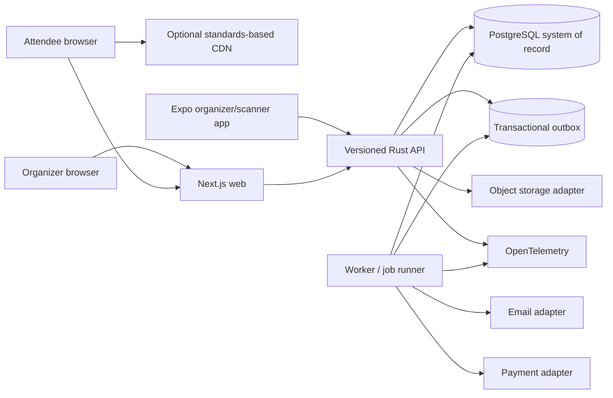

# System architecture

This document describes the intended modular-monolith architecture and future domain boundaries. It is not a diagram of every currently implemented feature. See [the implemented runtime map](IMPLEMENTED_RUNTIME.md) for the present Compose topology, trust boundaries, real reservation transaction, and explicit gaps.

## Starting shape

Start with a **modular monolith plus an independently scaled worker**, not many networked services. Orders, inventory, ticket issuance, and payment state need clear transactions and a comprehensible failure boundary. A single Rust application can enforce those rules with less latency, deployment machinery, and operational cost than several services.

Split a bounded context into a separate process only when measured load, independent ownership, regulatory isolation, or failure-containment needs justify that boundary. Preserve API and persistence contracts before such a split. Do not share database tables between future services after the split.

## Bounded contexts

The folder, crate, schema ownership, and public vocabulary should follow these contexts. A context can contain multiple modules; do not create empty crates for every noun.

| Context | Owns | Important boundary |
| --- | --- | --- |
| Identity | External identity subject, local account, login/link state, API clients, scanner devices | Authentication proves identity; it grants no tenant permissions by itself |
| Organizations and access | Tenant, membership, invitations, roles, policy assignments, subscription entitlements | Every tenant-owned query receives an authorized organization context |
| Event catalog | Event draft/publish, schedule, venue, ticket types, public listing, theme | Publicly cache only a deliberately published, privacy-reviewed projection |
| Orders and inventory | Checkout intent, reservations, order, line items, provider references, refund state | Atomic database state transitions and idempotency protect the money/inventory facts |
| Ticketing | Ticket credential, assignment, transfer, revocation, generated artifacts | QR value is a credential; never include attendee PII in the code |
| Entry | Device authorization, check-in events, admission quantity, correction, reconciliation | Append correction/audit facts; never silently overwrite scan history |
| Notifications | Message templates, consent, delivery jobs, retry/dead-letter state | At-least-once sending; use stable message and provider idempotency keys where available |
| Integrations | Signed webhooks, API credentials, provider adapters, import/export | Tenant-scoped secret management, signature validation, replay protection |
| Billing and entitlements | Subscription state, plan version, usage, invoices or provider references | Billing webhooks update entitlements idempotently; they do not rewrite ticket validity |
| Platform operations | Jobs, rate-limit observations, audit events, telemetry, outbox dispatcher | No product tenant authorization bypass through internal workers |

Use an explicit application service for transactions that cross contexts, such as order confirmation issuing tickets and enqueuing email. Context modules expose commands/queries and transaction needs, not their mutable ORM models to callers.

## Request and write flow

1. A gateway terminates TLS, applies coarse IP/request-size limits, and forwards the original request ID safely.
2. Axum validates versioned request schema, body size, idempotency key, identity, and route-specific authorization. Tenant and resource IDs from the path are untrusted until their membership and ownership are loaded.
3. The application use case begins a bounded PostgreSQL transaction, claims or replays the idempotency record, checks the event sales window, makes the inventory transition with a conditional write, records the order/payment intent and an outbox entry, then commits.
4. The web/mobile client receives a stable order and payment-instructions state; it does not infer purchase success from a redirect alone.
5. The worker claims outbox rows with a lease and bounded retry. It sends external requests outside the database transaction, stores the outcome, and applies provider webhooks with signature verification and replay/idempotency controls.

Never call a payment, email, object-storage, or identity provider while holding the inventory transaction open. Use a saga/state machine for cross-system completion; compensate with an explicit release, refund, or manual-review state rather than pretending a distributed transaction exists.

## Inventory and flash-sale behavior

PostgreSQL owns capacity, active holds, confirmed admissions, and order status. Creating a hold uses one transaction and an atomic capacity guard. The inventory count changes only if `available >= requested_quantity`; the successful hold records an owner, deadline, event/ticket type, quantity, and idempotency reference. Confirmation consumes a valid hold once. Expiration, cancellation, webhook redelivery, and retry all compete through legal state transitions, so the database serializes the facts even when clients and workers race.

Start with one inventory guard row per ticket type; the row is a deliberate serialization point that protects correctness. Load-test a hot event. If it becomes a bottleneck, assess per-event admission queues or quota-partitioned counters with an explicit policy for stranded capacity. Never add a cache lock or decrement a cache as the sole oversell defense.

Bound checkout quantity, hold duration, client retry rate, concurrent requests, database pool size, and work queues. Return a stable sold-out or temporarily-busy response. Reject excess work with a documented retry hint before it consumes all API and database capacity. Serve cached event pages for discovery, but show inventory as a verified checkout result rather than promising stale availability.

## Search and content

Start public event search in PostgreSQL: normalized tags/location/time fields, full-text search, and indexes that match filters and sort order. Validate plans and query budgets with representative event counts. Keep search behind a context API so an OpenSearch-compatible index can be evaluated later. Search is rebuildable from a publishable event projection; it is not a source of truth for sales, private details, or entitlements.

Theme customization is data: a versioned layout document, supported content blocks, brand tokens, logos, fonts with licenses, and a small approved component registry. Render public pages with accessible, semantic components. Offer an embeddable/headless React SDK and generated API clients for UI developers. Arbitrary tenant-supplied JavaScript would execute in an attendee browser and is outside the pilot. Any future custom-code sandbox needs a separate threat model.

## Runtime state and memory

API replicas are stateless across requests: do not keep authoritative tenant permissions, tickets, payment state, or sessions in process memory. Use bounded pools, connection/time budgets, finite request body limits, streaming upload/download limits, capped task concurrency, and shutdown drain deadlines. Cache only explicitly versioned, privacy-safe projections with an owner, TTL, invalidation path, maximum size, and measured hit-rate.

Rust removes garbage-collector pauses but does not eliminate resource leaks or unsafe behavior in dependencies. Monitor resident memory, allocator growth, queue depth, open DB connections, file descriptors, task cancellation, and dropped tasks. Do not spawn unbounded background tasks or retain request data in long-lived caches. Enforce clippy and dependency/security review after the runnable scaffold exists.

## Search, feeds, and caching boundaries

Use opaque cursors over stable sort keys for organizer and attendee history. Put a hard maximum on page size. Cache immutable/versioned public assets and published event content; never cache authenticated organizer responses in a shared CDN key. Treat invalidation as part of the publish/update transaction or its outbox event. Search-index lag and page cache age must be measurable and visible to incident response.

## Interfaces between contexts

Use direct application interfaces inside the modular monolith; use versioned HTTP for external API consumers; use outbox events for asynchronous notifications and integration fan-out. Name events as facts (`OrderConfirmed`, `TicketRevoked`) rather than instructions. Include event ID, schema version, tenant ID, occurrence time, causation/correlation ID, and unique event ID. Do not use tenant-controlled strings as metric labels.
